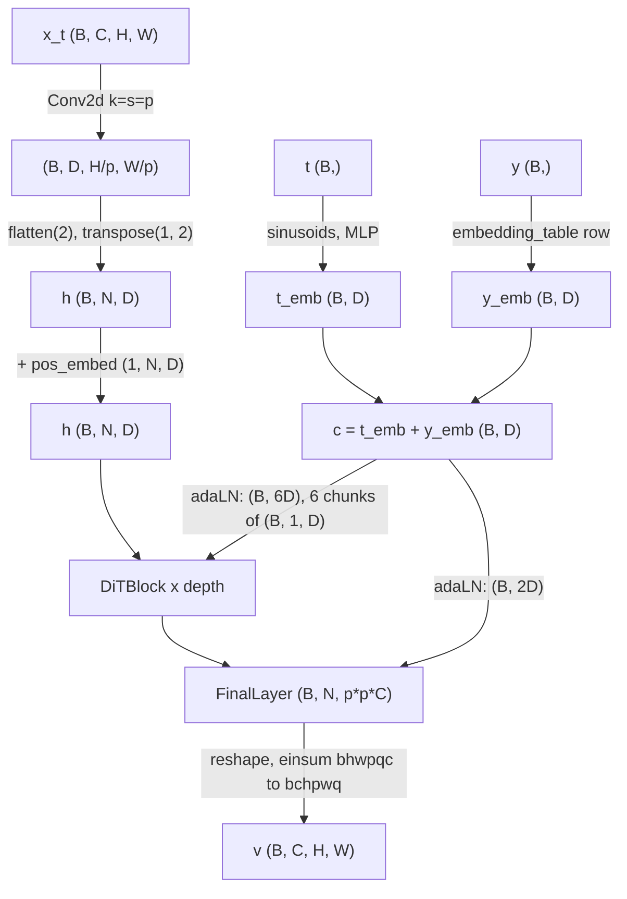
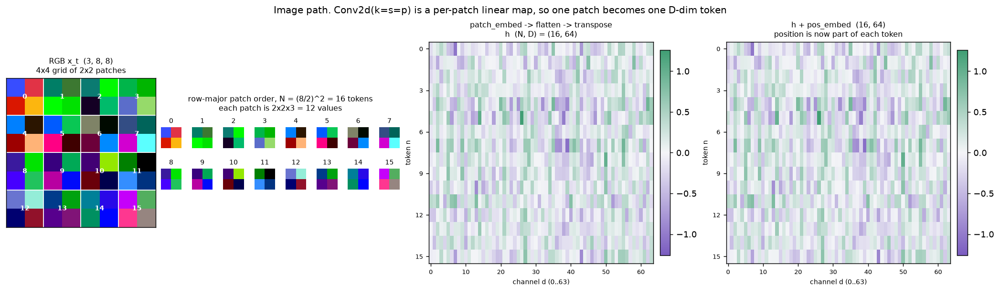
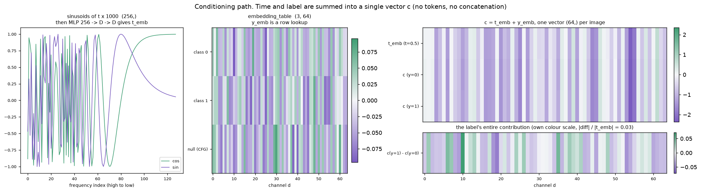
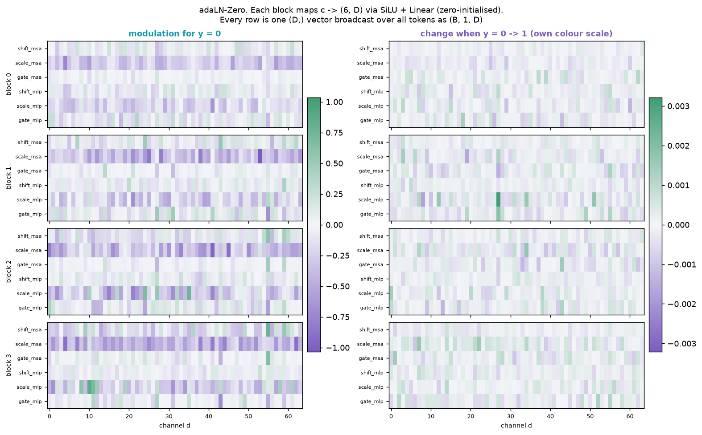
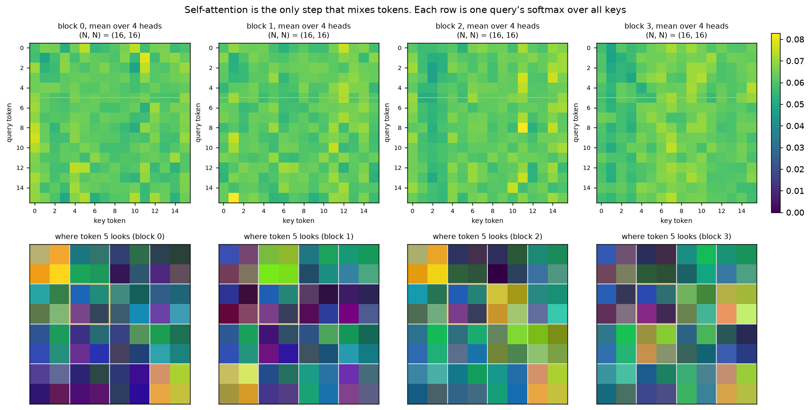
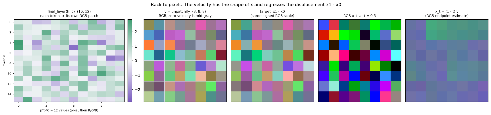
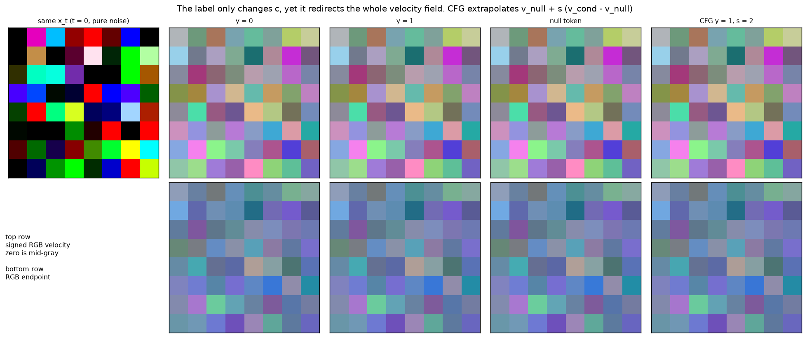

---
hide:
  - toc
---

# DiT Walkthrough

This page follows one forward pass of `deltaflow.models.DiT` tensor by tensor.
Every number comes from a real trained model. The showcase script replays
`DiT.forward` with the model's own submodules, asserts the result equals
`field(x, t, y)`, and exports every intermediate tensor for the guided tour
below.

The setup is a three-channel RGB variant of the 8x8 conditional DiT toy.
Class 0 is green above purple, class 1 swaps the two halves.
With `patch_size=2` the image becomes a
4x4 grid of patches, so the sequence has 16 tokens, which keeps every matrix
readable.

## Interactive tour

Start with the input image, then follow the named layers with **Next**.
Each transformer block exposes five operations, from attention normalisation
through the MLP residual. **Next operation** walks through them in order.
The output head and unpatchify finish the forward
pass. Guidance and sampling are separate extensions at the end.

Change the image, time, or label to compare real activations. Use the patch
selector or hover a tensor row to follow one patch. Shapes include a batch of
one, while heatmaps display token rows and feature columns. Open the detail
panels for convolution channels, attention heads, and conditioning gates.

The **RGB**, **R**, **G**, and **B** controls change only the image display.
The model always processes all three channels. RGB images clip values to
`[0, 1]` for display only. Signed RGB velocities map zero to mid-gray, while
individual velocity channels use a diverging colour scale. Hover to read the
original, unclipped RGB values.

<div id="dit-viewer" data-src="../../assets/dit-walkthrough/dit_trace.json"></div>

## Data flow at a glance

The key idea is that a DiT has **two separate paths**. The image becomes a
sequence of N tokens. Time and label collapse into **one vector `c` per image**.
The two paths never concatenate. `c` emits per-channel
`(shift, scale, gate)` vectors that are broadcast over every token
(adaLN-Zero, Peebles & Xie 2023). Conditioning can change attention weights
through the modulated queries and keys, but self-attention remains the only
operation that mixes tokens.



## Shapes along the forward pass

With `B=2`, `C=3`, `H=W=8`, `p=2`, `D=hidden_size=64`, `depth=4`, `num_heads=4`.
The script prints this table at run time.

| Step | Code | Shape |
|---|---|---|
| input | `x_t` | `(2, 3, 8, 8)` |
| patch embedding | `patch_embed(x)` | `(2, 64, 4, 4)` |
| merge grid | `.flatten(2)` | `(2, 64, 16)` |
| tokens first | `.transpose(1, 2)` | `(2, 16, 64)` |
| position | `+ pos_embed` | `(2, 16, 64)` |
| time | `t_embedder(t)` | `(2, 64)` |
| label | `y_embedder(y)` | `(2, 64)` |
| conditioning | `c = t_emb + y_emb` | `(2, 64)` |
| modulation per block | `adaLN_modulation(c)` | `(2, 384)` = 6 x 64 |
| attention weights | `softmax(q kᵀ / √d)` | `(2, 4, 16, 16)` |
| block output | `h` | `(2, 16, 64)` |
| output head | `final_layer(h, c)` | `(2, 16, 12)` = p·p·C per token |
| back to pixels | `_unpatchify` | `(2, 3, 8, 8)` |

So `N = (H/p)·(W/p)` is the number of tokens and `D` is the width of each token.

The sections below are a static, read-along version of the same tour.

## 1. Image path, patches become tokens



A `Conv2d` with `kernel_size = stride = p` sees each non-overlapping patch
exactly once, so it is a single linear map applied to every flattened patch
(`p·p·C = 12` channel values to `D` features). The input patch matrix groups
all R pixels, then G, then B, matching flattened Conv2d weights.
`flatten(2)` merges the 4x4 grid into 16
positions in row-major order, and `transpose(1, 2)` puts tokens first, giving the
`(B, N, D)` layout a transformer expects. Attention is permutation-equivariant,
so the learned `pos_embed` is the only thing that tells token 5 it sits in row 1,
column 1.

## 2. Conditioning path, time and label become one vector



Time is multiplied by `time_scale` (1000), expanded into 256 sinusoids (fast to
slow frequencies), then passed through a two-layer MLP to give `t_emb`. The label
is a plain row lookup in `embedding_table`, which has `num_classes + 1` rows. The
extra row is the **null token** used for classifier-free guidance. The two are
summed, so `c` is one `(D,)` vector per image. The bottom-right panel isolates
`c(y=1) - c(y=0)`, which is the label's entire contribution to the network.

## 3. adaLN-Zero, how `c` steers the tokens



Each block maps `c` through `SiLU` and a `Linear(D, 6D)` and splits the result
into six `(D,)` vectors. Each sub-layer (attention, then MLP) applies

$$
h \leftarrow h + \text{gate} \odot \text{sublayer}\big(\text{LN}(h)\,(1 + \text{scale}) + \text{shift}\big).
$$

The vectors are unsqueezed to `(B, 1, D)`, so **the same values apply to all
16 tokens**. Conditioning changes how each channel is normalised and how much of
each residual branch is let through. It can change attention weights through
the modulated queries and keys, without adding a separate attention mask.
The right column shows how much each modulation moves when only the label
flips. The `Linear` that produces them is zero-initialised (the "Zero" in
adaLN-Zero), so at initialisation every gate is zero, every block is the
identity, and the field outputs `v = 0`. Training departs smoothly from that
fixed point.

## 4. Self-attention, the only token mixing



Top row, each `(N, N)` map is the softmax of one query (row) over all keys
(columns), averaged over heads. Bottom row, query token 5 (yellow box) projected
back onto the RGB image. Compare blocks and heads to inspect how each patch
mixes information from the rest of the image. Attention weights describe that
mixing, not a causal explanation of the predicted colours.

## 5. Back to pixels, the velocity is the displacement



`FinalLayer` applies one last adaLN modulation, then a `Linear(D, p·p·C)`, so
each token emits 12 values, grouped as R, G, B for each pixel of its own patch.
This differs from the channel-first patch layout at the input.
`_unpatchify` reshapes to
`(B, n, n, p, p, C)` and the einsum `bhwpqc -> bchpwq` interleaves grid and
in-patch indices back into `(B, C, H, W)`. The prediction regresses the
flow-matching target, the displacement $\Delta = x_1 - x_0$ between the noise
and data distributions. Following it for the remaining time,
$x_t + (1 - t)\,v$, estimates the clean RGB image.

## 6. What the label does, and classifier-free guidance



At `t = 0` the input is pure noise, so it carries no class information and any
difference between columns comes from the label alone. `y = 0` points to a
green top and `y = 1` to a green bottom. The null token points to a
blend of the two classes. Classifier-free guidance
(Ho & Salimans, 2022) extrapolates away from that blend,

$$
v_\text{cfg} = v_\text{null} + s\,\big(v_\text{cond} - v_\text{null}\big),
$$

and `DiT.forward_with_cfg` computes both terms in one batched forward pass.

## Reproduce

```bash
pip install -e ".[dev]" matplotlib
python examples/90-showcase/10-dit-tensor-viz/main.py
# artifacts are written to outputs/dit_tensor_viz/
# copy the PNGs and dit_trace.json to docs/assets/dit-walkthrough/ to refresh this page
```

See also the [conditional DiT training example](../examples.md#20-training-conditional-generation-with-a-dit)
and the [`models` API reference](../api/models.md).

**References.** Peebles & Xie, *Scalable Diffusion Models with Transformers*
(2023), [arXiv:2212.09748](https://arxiv.org/abs/2212.09748). Ho & Salimans,
*Classifier-Free Diffusion Guidance* (2022),
[arXiv:2207.12598](https://arxiv.org/abs/2207.12598).
