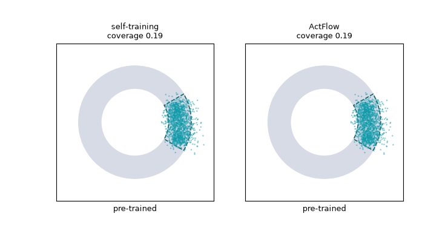

# Active Flow Expansion

Flow matching learns to reproduce its training density. Some questions need
more than that. In drug or protein design, and in data-scarce imaging, the
interesting designs are often valid but absent from the data, so the model
assigns them negligible probability and never generates them.

Active Flow Expansion (ActFlow, De Santi et al., 2026,
[arXiv:2606.08802](https://arxiv.org/abs/2606.08802)) changes the goal from
matching $p_\text{data}$ to growing the model's **generable set**,

$$
\Omega^\tau_\theta = \{x : p^\theta_1(x) \ge \tau\},
$$

until it covers as much of the valid design space $\Omega^*$ as possible.
Validity is judged by a black-box **verifier**, which can only be queried on
designs the model can already generate. Expansion is therefore recursive.
Each round, the model generates queries, the verifier labels them, and the
model is fine-tuned on the result.

In DeltaFlow's displacement view, plain self-training keeps re-learning the
displacement $\Delta$ toward modes the flow already reaches. ActFlow chooses
*which* endpoints the field is retrained to reach, so the learned transport
extends into new valid regions.



The [active flow expansion showcase](../examples.md#90-showcase-active-flow-expansion)
walks through this comparison and the uncertainty maps behind it.

## Algorithm

At round $t$, with query history $\mathcal{D}_t = \{(x_i, y_i)\}$,

1. **Fit uncertainty.** Read features $\phi_s(x_i)$ from the *current*
   velocity field at noise level $s$ and fit the verifier uncertainty
   $\sigma_t$ (Eq. 10),

    $$
    \sigma_t^2(x) = k(x, x) - k(x, X_t)\bigl(K_t + \lambda I\bigr)^{-1} k(X_t, x).
    $$

2. **Self-generate.** Sample from the KL-regularised exploration objective
   (Eq. 9),

    $$
    \tilde{p}_t = \arg\max_q\; \mathbb{E}_q\bigl[\sigma_t(\phi_s(x))\bigr]
    {}- \beta\,\mathrm{KL}\bigl(q \,\Vert\, p^{\theta_t}_1\bigr)
    \;\propto\; p^{\theta_t}_1(x)\,\exp\bigl(\sigma_t(\phi_s(x))/\beta\bigr).
    $$

3. **Query.** $y_{t+1} = \tilde{v}(x_{t+1})$, append to $\mathcal{D}_t$.
4. **Update the flow** with signed replay (Apx. D.1),

    $$
    \mathcal{L}^\text{signed}_t = \hat{\mathcal{L}}^{+}_t - \alpha_t\,\hat{\mathcal{L}}^{-}_t,
    $$

    where accepted samples attract mass and rejected samples repel it.

$\beta \to \infty$ recovers plain self-training. $\beta \to 0$ is pure
uncertainty maximisation, which may leave the region where the model prior
still gives a useful validity bias.

## Components

Each step is a separate, swappable DeltaFlow component.

| Step | Component | Notes |
|---|---|---|
| $\phi_s$ | `FlowRepresentation` | hooks any sub-module of the velocity field, pools tokens or feature maps |
| $\sigma_t$ | `KernelUncertainty` | linear (paper default) or RBF kernel, differentiable, automatic primal form when $t > D$ |
| tilt | `UncertaintyGuidance` | exposes $\exp(\sigma_t/\beta)$ as a `Likelihood`, so `PosteriorSolver` samples it |
| update | `SignedReplayFlowMatchingLoss` | fixed $\alpha$, or the paper's gradient-norm calibration |
| loop | `ActFlow` | Algorithm 1, buffers, warm-up, per-round summaries |
| metric | `generable_coverage` | histogram coverage and validity for 2D problems |

The tilt reuses the posterior-sampling machinery. Sampling
$p_\theta \exp(\sigma/\beta)$ is a posterior problem with
$\exp(\sigma/\beta)$ in place of a measurement likelihood, so
`PosteriorSolver` applies $\nabla \sigma_t(\phi_s(\hat{x}_1)) / \beta$ on the
Tweedie estimate at every step, exactly as it does for inverse problems (see
[Inverse Problems](inverse-problems.md)).

## Usage

```python
import torch
from deltaflow.expansion import ActFlow, FlowRepresentation, KernelUncertainty
from deltaflow.losses import SignedReplayFlowMatchingLoss

act = ActFlow(
    model,                                   # pre-trained velocity field
    verifier,                                # x -> bool tensor [B]
    torch.optim.Adam(model.parameters(), lr=1e-3),
    sample_shape=(2,),
    representation=FlowRepresentation(model, s=0.9, layer="net.3"),
    uncertainty=KernelUncertainty(kernel="linear", reg=1e-2),
    loss=SignedReplayFlowMatchingLoss(alpha=0.05, alpha_mode="grad_norm"),
    beta=0.1,
    guidance_scale=1.0,
)
for r in act.run(n_rounds=20, n_samples=128):
    print(r.round, r.acceptance_rate, r.mean_uncertainty)
```

## Practical notes

- **Feature level $s$.** The paper's ablation finds features read close to
  the data end work best, but not at it. The default is $s = 0.9$.
- **Tilt strength.** The effective per-step push is
  $\eta / \beta \cdot \nabla \sigma$, with $\eta$ the `guidance_scale`.
  With L2-normalised features the linear-kernel $\sigma$ is small, so
  $\eta$ usually needs to be of order one. Watch the acceptance rate. If it
  collapses, the tilt is leaving the valid region, so raise $\beta$.
- **Repulsion.** $\alpha = 0$ (flow matching on accepted samples only) is
  often enough. With `alpha_mode="grad_norm"`, $\alpha$ is the fraction of
  the accepted-sample gradient norm given to the rejected-sample term, which
  keeps the unbounded repulsive loss under control.
- **Other uncertainty models.** Subclass `BaseUncertainty` (for example a
  bootstrapped MLP ensemble, as in the paper's molecular experiments). Keep
  `__call__` differentiable so it can steer sampling.

See [`examples/20-training/04-active-flow-expansion`](../examples.md#20-training-active-flow-expansion)
for a runnable 2D demonstration, and the [API reference](../api/expansion.md).
