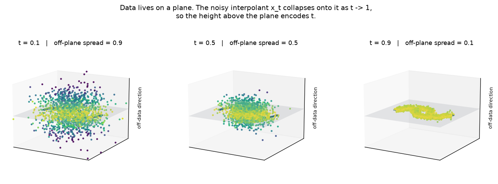
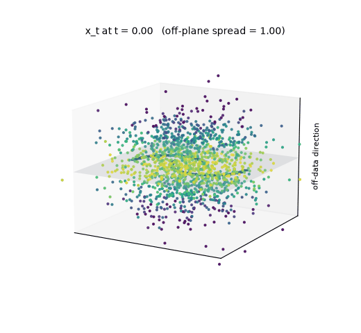
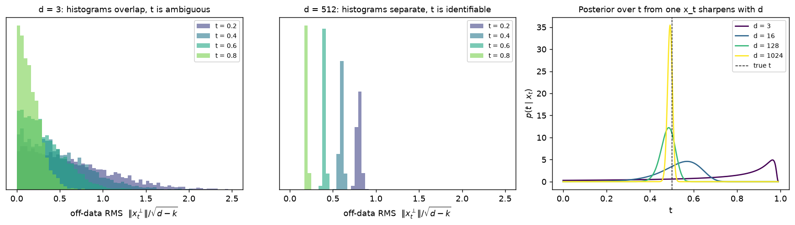
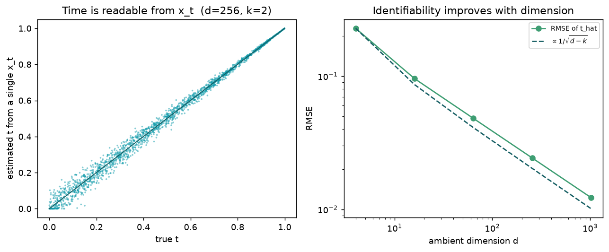
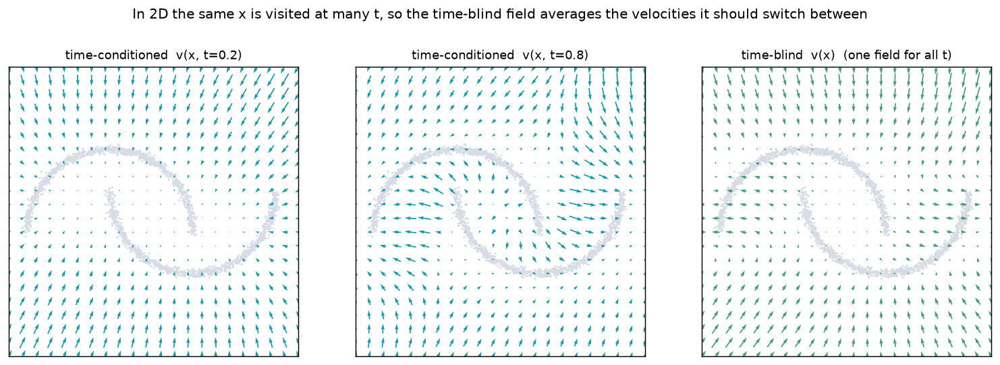
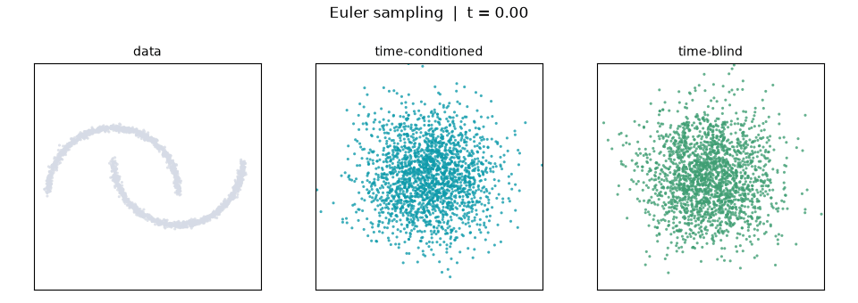

# Time-Unconditioned Flow Matching

Standard flow matching trains a velocity field \(v_\theta(x_t, t)\) that is told
the interpolation time \(t\). Time-unconditioned (time-blind) flow matching
drops that input and trains \(v_\theta(x_t)\) instead:

\[
\mathcal{L}_\text{blind} = \mathbb{E}_{t,\, x_0,\, x_1}
    \bigl\| v_\theta(x_t) - u_t \bigr\|^2,
\qquad x_t = (1-t)\,x_0 + t\,x_1,\quad u_t = x_1 - x_0 .
\]

It sounds like it should fail, because the same point \(x_t\) can be reached at
different times with different target velocities. In practice it works well on
images. This guide explains why, following
"What Time Is It? How Data Geometry Makes Time Conditioning Optional for Flow
Matching" ([arXiv:2605.08344](https://arxiv.org/abs/2605.08344)).

```python
from deltaflow.losses import TimeUnconditionedFlowMatchingLoss
from deltaflow.models import TimeBlindVelocityField

v_theta = TimeBlindVelocityField(net)          # net(x, **cond) -> velocity
loss_fn = TimeUnconditionedFlowMatchingLoss()  # calls v_theta(x_t, **cond)
loss = loss_fn(v_theta, x1)
```

`TimeBlindVelocityField` accepts and ignores `t`, so the existing solvers
(`EulerSolver`, `HeunSolver`, ...) sample it unchanged.

## What a time-blind model can learn

The best a time-blind model can do is average the target over every time that
could have produced \(x\):

\[
v^*_\text{blind}(x) = \mathbb{E}\bigl[u_t \mid x_t = x\bigr]
  = \int_0^1 p(t \mid x)\; v^*(x, t)\, dt .
\]

This average gives two sources of irreducible error:

- **Coupling variance.** Even if \(t\) is known, many \((x_0, x_1)\) pairs pass
  through the same \(x_t\) with different \(u_t\). Every flow matching model
  pays this, and it depends on how noise is paired with data (the coupling).
- **Time-blindness gap.** The extra error from averaging over \(p(t \mid x)\).
  It is zero exactly when \(p(t \mid x)\) is a spike, that is, when \(t\) can
  be read off \(x\).

So the question is not whether the model needs time, but whether time is
already written into \(x_t\).

## Where time hides: the geometry of data

Real data is not spread through all of \(\mathbb{R}^d\). It concentrates near a
low-dimensional set (approximately a \(k\)-dimensional subspace, with
\(k \ll d\)). Split any point into a part along the data and a part
orthogonal to it, \(x = x^\parallel + x^\perp\). Data has \(x_1^\perp \approx 0\),
so

\[
x_t^\perp = (1-t)\, x_0^\perp .
\]

The orthogonal part is pure Gaussian noise, shrunk by \((1-t)\). Its height
above the data encodes how far along the path the point is.



Here two-moons sits on the \(z=0\) plane of \(\mathbb{R}^3\) (\(d=3, k=2\)).
Colour is distance from the plane. At small \(t\) the cloud is thick; by
\(t = 0.9\) it has collapsed onto the moons.



## Why dimension matters: concentration of measure

With a single orthogonal direction (\(d - k = 1\)) the height is one Gaussian
draw times \((1-t)\), which is far too noisy to pin \(t\) down. A point near the
plane could be late in the path, or early with a small noise draw. With many
orthogonal directions the noise averages out:

\[
\frac{\|x_t^\perp\|^2}{d-k} = (1-t)^2 \cdot \frac{\chi^2_{d-k}}{d-k}
  \;\xrightarrow{\;d-k \to \infty\;}\; (1-t)^2 ,
\]

so \(\hat t = 1 - \|x_t^\perp\| / \sqrt{d-k}\) recovers \(t\) from a single
observation, with error \(O(1/\sqrt{d-k})\).



- **Left (\(d = 3\)).** The off-data RMS for \(t = 0.2, \ldots, 0.8\) overlaps
  heavily, so a single \(x_t\) is consistent with almost any \(t\).
- **Middle (\(d = 512\)).** The same distributions become narrow, separate
  spikes at \(1 - t\), so \(t\) is identifiable.
- **Right.** The posterior \(p(t \mid x_t)\) for one observation at true
  \(t = 0.5\) goes from flat at \(d = 3\) to a spike at \(d = 1024\).



When \(p(t \mid x)\) is a spike, the average in \(v^*_\text{blind}\) collapses
to the single correct time, and the time-blindness gap vanishes. The network
does not need \(t\) as an input because it can read \(t\) from \(x\). For a
\(32 \times 32 \times 3\) image, \(d = 3072\) and \(d - k\) is in the
thousands.

## What goes wrong in low dimensions

The same argument predicts failure on 2D toys, where the data fills the space
and there is no orthogonal direction (\(d - k = 0\)). The
[showcase](../examples.md#90-showcase-time-unconditioned-flow-matching) trains
both models on two-moons:



The conditioned field changes over time. At \(t = 0.2\) it pulls inward
globally; at \(t = 0.8\) it pushes points sideways onto the individual moons.
The time-blind field must be one compromise between them, so it loses the late,
fine-grained steering.



The result is samples smeared between the moons and a higher training loss.
This is the time-blindness gap made visible.

## Practical takeaways

- **High-dimensional data (images, audio, latents).** Time conditioning is
  largely optional. A time-blind model is simpler (no time embedding, no
  adaLN time path) and loses little.
- **Low-dimensional or dense data (2D toys, tabular data with few features).**
  Keep time conditioning. Here \(t\) is not identifiable from \(x_t\).
- **The coupling is the bigger lever.** The paper finds that changing the
  coupling (independent against minibatch OT) moves loss and sample quality
  far more than removing \(t\). `TimeUnconditionedFlowMatchingLoss` accepts the
  same `coupling=` argument as `ConditionalFlowMatchingLoss`.
- **Backbones that require `t`.** Pass `pass_time=True` to feed a constant zero
  time, which carries no information.

## Reproduce

```bash
pip install -e ".[dev]" matplotlib
python examples/90-showcase/12-time-unconditioned-fm-viz/main.py
# artifacts are written to outputs/time_unconditioned_fm_viz/
```
